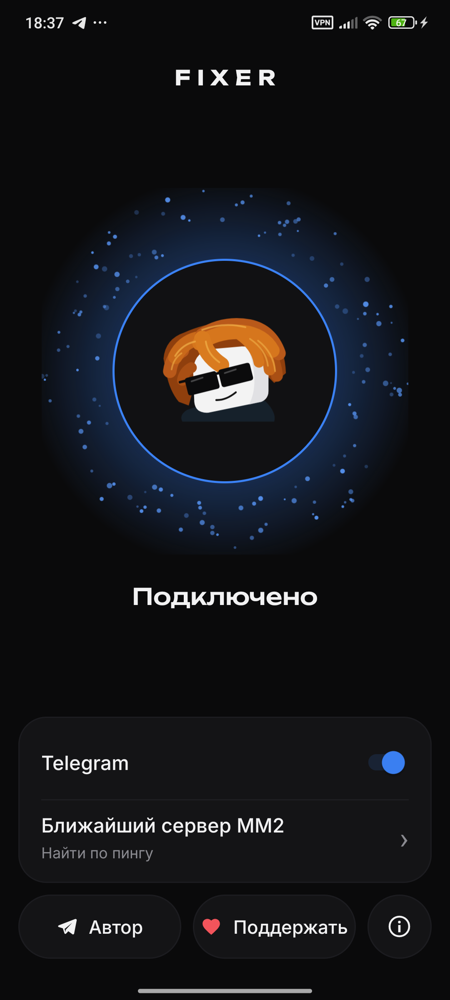

<div align="center">

**[Русский](README.md) | English**

# Fixer

**One button, and Roblox, YouTube and Telegram work again on Android.**

[](https://github.com/sanyakiller111/Fixer/actions/workflows/android.yml)

[](../../releases/latest)
[](LICENSE)

[Download APK](../../releases/latest) | [Support](https://pay.cloudtips.ru/p/03c080d5)



</div>

> [!CAUTION]
> **Antivirus engines may flag the APK.** A couple of engines on VirusTotal label it
> as a "dropper". The reason is that the app installs its own updates (the
> `REQUEST_INSTALL_PACKAGES` permission) and runs a local VPN. Fixer does not download
> or install any other apps. The source code is open, and each release lists its
> SHA-256 in the description: compare it with the hash of the file you downloaded.
> [VirusTotal report](https://www.virustotal.com/gui/file/ace2f13708bb11a6bd2e1190ea61ce13b757ffd5175732900cd340f9687abf98)

## What it is

Fixer is a local VPN for Android. It **does not route traffic through someone else's
server**: everything is handled on the phone itself. It fixes three things that break
with Russian ISPs:

| Service | What is broken | What Fixer does |
|---|---|---|
| **Roblox** | Icons and avatars do not load, games do not open | DNS over Google DoH with ECS 0/0, game UDP goes direct |
| **YouTube** | Videos do not open at all | DPI bypass via [byedpi](https://github.com/hufrea/byedpi) |
| **Telegram** | IP addresses are fully blocked | Local MTProto proxy, then WebSocket, then a Cloudflare Worker |

Only the chosen apps (Roblox, YouTube, browsers) go through the VPN. The rest of the
phone's traffic is untouched.

## Quick start

1. Download `fixer.apk` from [Releases](../../releases/latest).
2. Install it (allow installs from unknown sources).
3. Open Fixer, tap the big button and allow the VPN.
4. For Telegram, switch on the **Telegram** toggle and confirm adding the proxy.

## Build

```bash
./gradlew assembleRelease
```

The APK appears in `app/build/outputs/apk/release/`. You need JDK 17 and Android SDK 34.
Native libraries are already in the repository, rebuild them only if you change `native/`.

## Privacy

Fixer collects no statistics and has no server of its own. DNS queries of the chosen
apps go to Google or Cloudflare DoH. Telegram traffic goes through a Cloudflare Worker
on the domain set in the app (the author's domain by default). You can set your own
domain in the app.

## Credits

[hufrea/byedpi](https://github.com/hufrea/byedpi) provides the DPI bypass (MIT).
[heiher/hev-socks5-tunnel](https://github.com/heiher/hev-socks5-tunnel) provides TUN to SOCKS5 (MIT).
[Flowseal/tg-ws-proxy](https://github.com/Flowseal/tg-ws-proxy) inspired the MTProto-over-WebSocket scheme and the Worker (MIT).

## License

[MIT](LICENSE). Author on Telegram: [@sanyakiller111](https://t.me/sanyakiller111).
